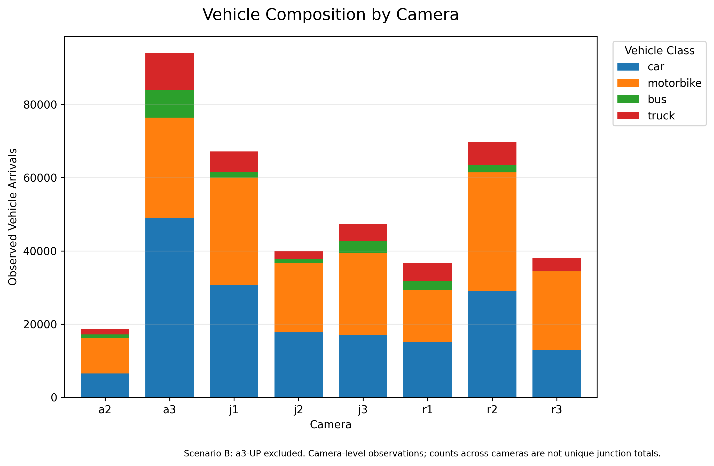
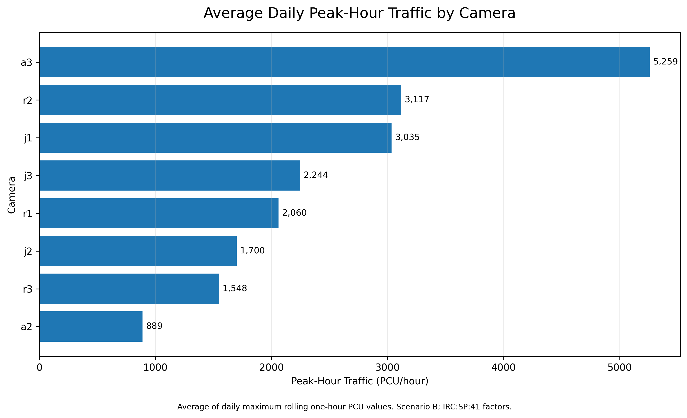
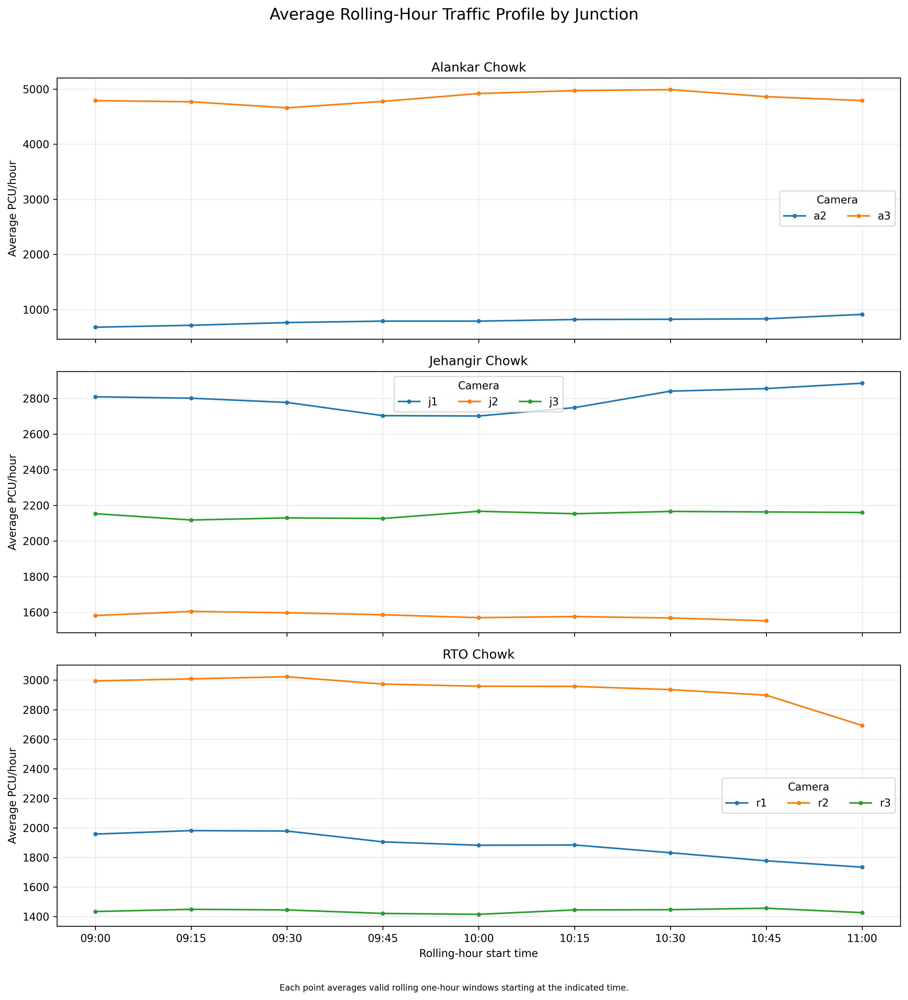
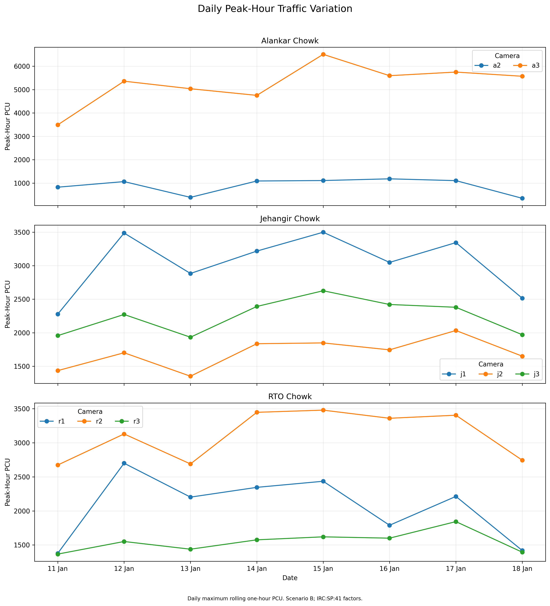
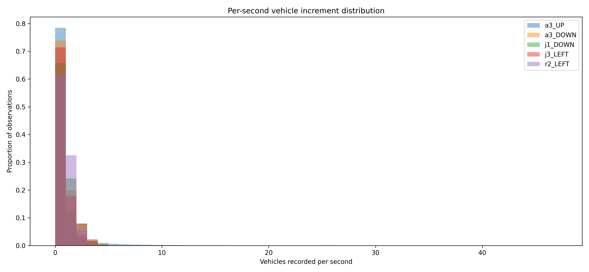
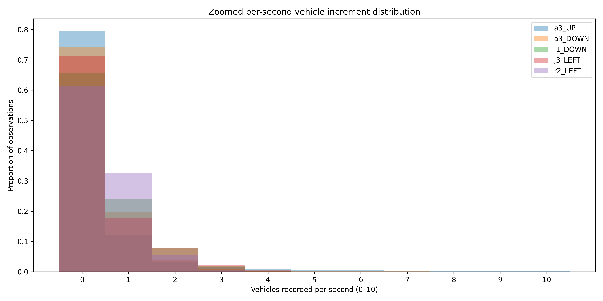

# Performance Evaluation of Pune's Heterogeneous Traffic: A Camera-Based Study

**Course:** CE60134 – Analysis and Evaluation of Transportation Systems  
**Assignment:** Performance Evaluation of an Urban Transportation System and Assessment of ITS Interventions

**Course Instructor:** Prof. Nandan Maiti, Department of Civil Engineering, IIT Kharagpur 

**Study area:** Alankar Chowk, Jehangir Chowk and RTO Chowk, Pune, Maharashtra, India 
 
**Study period:** 11–18 January 2023

---

## 1. Project Overview

This project analyses classified vehicle-count data collected from CCTV recordings at three intersections in Pune. It develops a reproducible data-processing workflow to reconstruct vehicle-arrival counts from cumulative counter records, examine data quality, estimate traffic volume and passenger-car-unit (PCU) measures, compare camera-level traffic patterns, and identify locations and movements that merit further investigation.

The work uses a **secondary, open-source dataset** rather than original field observations. The analysis is intended as a data-led screening assessment. The available files do not contain the full set of operational and safety measurements required for a complete intersection performance evaluation; these limitations are documented below.

## 2. Study Area

The dataset covers cameras associated with three Pune junctions:

- **Alankar Chowk** – camera identifiers beginning with `a` (including `a2` and `a3`).
- **Jehangir Chowk** – camera identifiers beginning with `j` (`j1`, `j2`, `j3`).
- **RTO Chowk** – camera identifiers beginning with `r` (`r1`, `r2`, `r3`).

[Open the interactive study-area map](Pune_Study_Area_OSM.html).

The camera identifiers and the dataset's `UP`, `DOWN`, `LEFT` and `RIGHT` labels are retained as supplied. The available documentation does not establish a verified mapping between these labels and compass directions, nor does it establish that the three junctions form one continuous corridor. The map is therefore a geographic study-area reference, not a verified camera-orientation or corridor-connectivity diagram.

## 3. Dataset and Source

The project uses the **Heterogeneous Traffic Count Dataset, Pune (Jan 2023)**. The dataset documentation describes CCTV-based vehicle detection, classification and tracking at three Pune junctions during 11–18 January 2023. The recorded vehicle classes are:

- Car
- Motorbike
- Bus
- Truck

The raw archive is stored locally at `data/original/traffic.zip`. The project also retains data-quality audit files under `data/processed/` and analysis outputs under `outputs/`.

**Dataset citation**  
Matange, A., & Abraham, J. (2026). *Heterogeneous Traffic Count Dataset, Pune (Jan 2023)* (Version 1). Mendeley Data. https://doi.org/10.17632/xnf2k6n288.1

The dataset is made available under the Creative Commons Attribution 4.0 International (CC BY 4.0) licence. Please consult the source record and accompanying documentation for attribution and reuse conditions.

## 4. Data Processing and Methodology

### 4.1 Raw-data inspection and validation

The raw CSV files contain repeated records for each timestamp and direction. The processing workflow groups records by timestamp and direction and retains the maximum cumulative counter value for each vehicle class. It then calculates per-second increments from successive counter observations.

Primary and continuation (`_one`) files are processed as separate counter segments because continuation files restart their counters. Overlapping timestamps are checked to avoid double-counting during segment combination. The scripts generate file-level, segment-level and counter-continuity audit outputs.

### 4.2 Traffic-volume analysis

Reconstructed increments are aggregated into daily, hourly and 15-minute summaries. Coverage checks are used to identify intervals with incomplete observations. Outputs include vehicle-class composition, camera-level summaries, peak periods and time-of-day profiles.

### 4.3 Data-quality sensitivity analysis

The `a3` camera's `UP` direction exhibits a substantially heavier upper tail of per-second car-count increments than other camera-direction series. The project therefore compares:

- **Scenario A:** all camera-direction observations retained.
- **Scenario B:** `a3-UP` excluded as a sensitivity case.

Scenario B is not asserted to be the true or corrected traffic count. The available count files do not include video footage or independent ground-truth observations with which to determine whether the high increments represent genuine arrivals or tracking/counting behaviour. The original observations are retained, and the sensitivity comparison makes the influence of this series explicit.

### 4.4 PCU estimation

The analysis applies the PCU factor set labelled `IRC_SP41` as its primary calculation and an `IRC106_High_Composition` factor set as a comparison. These are analytical assumptions applied to the available vehicle classes; they should not be interpreted as a site-specific capacity calibration. The PCU outputs are used for comparative screening, not as a direct measurement of junction capacity or level of service.

### 4.5 Camera and junction profiles

Camera-level directional observations are combined to produce camera-level interval profiles. These results are reported by camera identifier and associated junction. Counts from different cameras are not automatically summed into a junction-wide total because camera fields of view and possible overlap have not been independently verified.

## 5. Selected Results and Visualisations

The figures below are generated by the analysis scripts and are stored in `outputs/figures/` or `outputs/`.

### 5.1 Vehicle composition by camera

The chart compares the observed vehicle-class composition across cameras for the sensitivity scenario that excludes `a3-UP`.



### 5.2 Average peak-hour PCU by camera

This figure compares camera-level peak-hour PCU indicators. It is a comparative demand indicator and does not represent a measured volume-to-capacity ratio.



### 5.3 Rolling-hour traffic profile

The rolling-hour profile illustrates how the observed traffic indicator varies over the recorded periods.



### 5.4 Daily peak-hour variation

This figure shows variation in the camera-level peak-hour indicator across the observed dates.



### 5.5 Per-second increment distribution

These diagnostic figures compare the distribution of reconstructed per-second increments and provide a closer view of the upper tail.





## 6. Main Analytical Observations

The analysis supports the following cautious observations:

1. Vehicle-arrival increments can be reconstructed from the cumulative counters after collapsing repeated timestamp-direction records and processing counter-reset segments separately.
2. The `a3-UP` series has a pronounced upper tail, particularly in car increments. Its inclusion materially affects aggregate counts and PCU comparisons; results are therefore presented with and without this series.
3. When `a3-UP` is excluded, `r2` and `a3-DOWN` remain among the higher camera-direction PCU indicators under the primary factor set. `j1` is also a relatively high camera-level series. These are screening results, not proof of congestion.
4. Camera-direction labels are not verified turning movements or compass orientations. Camera totals may also overlap spatially; cross-camera sums should not be interpreted as unique network traffic without further validation.

For detailed numerical results, see the CSV files in `outputs/`, including `sensitivity_total_comparison.csv`, `sensitivity_vehicle_composition.csv`, `pcu_camera_direction_summary.csv`, `camera_summary_by_junction.csv`, and the corrected peak-profile outputs.

## 7. Limitations and Further Data Required

The supplied dataset provides classified vehicle counts, timestamps, camera identifiers and direction labels. It does **not** provide independently verified measurements of:

- Spot speeds or travel-time runs
- Control delay or stopped delay
- Queue lengths or signal timings
- Approach geometry, lane configuration or saturation flow/capacity
- Pedestrian and cyclist volumes or crossing-conflict observations
- Bus routes, headways, dwell times or schedule reliability
- Parking activity and curbside interference

Consequently, this project does not claim measured level of service (LOS), volume-to-capacity (v/c) ratios, intersection delay, queue length, pedestrian safety performance or bus reliability. Such measures require additional field observations or suitable verified supplementary data. Any proposed ITS intervention or impact estimate should be treated as a preliminary scenario until supported by site-specific operational data, costs and validation.

Other limitations include potential vehicle-detection and tracking errors, occlusion and lighting effects, the restricted set of four vehicle classes, variable recording sessions, and the absence of video for independent validation of unusual increments.

## 8. Repository Structure

```text
Pune_Transportation_Assignment/
├── data/
│   ├── original/
│   │   └── traffic.zip
│   └── processed/          # Reconstructed data and validation/audit files
├── outputs/                # Aggregated results, sensitivity tables and figures
│   └── figures/
├── scripts/                # Sequential data-processing and analysis scripts
├── Pune_Study_Area_OSM.html
└── README.md
```

Large intermediate generated CSV files may be excluded from version control to keep the repository within hosting limits. They can be regenerated using the scripts and the original dataset archive.

## 9. Reproducibility

### Requirements

- Python 3.9 or later is recommended.
- Packages used by the analysis include `pandas`, `numpy` and `matplotlib`.
- `openpyxl` may be required if working with Excel outputs.

Install the core dependencies from the project root:

```bash
python -m pip install pandas numpy matplotlib openpyxl
```

### Run order

Run commands from the **project root directory** (`Pune_Transportation_Assignment/`), so relative input and output paths resolve correctly.

The main processing and analysis workflow is:

```bash
python scripts/01_raw_data_audit.py
python scripts/02_validate_segments.py
python scripts/03_check_counter_continuity.py
python scripts/04_compare_overlap_counts.py
python scripts/05_inspect_counter_boundaries.py
python scripts/06_build_corrected_dataset.py
python scripts/07_traffic_volume_analysis.py
python scripts/08_hourly_traffic_analysis.py
python scripts/09_pcu_analysis.py
python scripts/10_time_of_day_profile.py
python scripts/22_sensitivity_analysis.py
python scripts/23_pcu_sensitivity_analysis.py
python scripts/24_pcu_rate_analysis.py
python scripts/25_junction_peak_profile.py
python scripts/26_vehicle_composition_peak_hour.py
python scripts/27_create_analysis_charts.py
```

Scripts `11`–`21` are additional diagnostic and sensitivity-inspection utilities. They can be run when investigating counter semantics, unusual increments and the `a3-UP` series. Some scripts depend on intermediate outputs produced by earlier steps; follow the input paths and checks in each script if running an individual diagnostic.

The raw archive must be present at `data/original/traffic.zip`. Generated outputs are written to `data/processed/` and `outputs/`.

## 10. Licence and Responsible Use

The source dataset is attributed above under CC BY 4.0. The analysis code and derived visualisations in this repository are provided for academic and reproducibility purposes. Users should retain the dataset attribution, document any changes, and avoid presenting camera-level counts or scenario estimates as independently validated traffic, capacity, safety or operational measurements.

---

*Prepared as an academic transportation-systems analysis project. Interpretations are limited to the coverage and quality of the available secondary dataset.*
